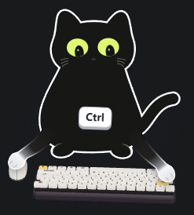

<h1 align="center">打字猫 · Typing Cat</h1>

<p align="center">一只住在 Windows 桌面上的猫。它会跟着你敲键盘、用鼠标，闲下来就打盹。</p>

<p align="center">
  <strong><a href="https://github.com/996wuxian/typing-cat/releases">下载 Windows 版</a></strong>
  &nbsp;·&nbsp; <a href="#快速上手">快速上手</a>
  &nbsp;·&nbsp; <a href="#本地开发">本地开发</a>
</p>

<table align="center">
  <tr>
    <td align="center">
      
      <br /><strong>夜猫打字</strong>
    </td>
    <td align="center">
      
      <br /><strong>夜猫打盹</strong>
    </td>
  </tr>
</table>

## 快速上手

1. 打开 [GitHub Releases](https://github.com/996wuxian/typing-cat/releases)。下载 `typing-cat.exe` 可直接运行，也可以选择名称以 `-setup.exe` 结尾的安装包。
2. 在猫咪窗口内打字，或直接点击画面中的键帽。按 `Esc` 打开菜单，可在 **3D 灰猫 · 深灰键盘** 和 **2D 夜猫 · 奶白键盘** 之间切换，也可以调整窗口大小。
3. 想让猫咪跟着其他窗口里的键盘输入动起来，可以开启「后台打字」。应用只响应支持的键位，不转换或保存输入文本。

按住 `Alt` 并用鼠标左键拖动，可以把猫咪挪到桌面的其他位置。

关闭窗口或按 `Alt+F4` 会最小化到任务栏。点击任务栏图标或再次启动打字猫即可恢复窗口。要结束应用，可右键通知区域的猫咪图标，选择「退出打字猫」。

## 试试这些互动

| 操作 | 猫咪的反应 |
| --- | --- |
| 按住键盘上的键 | 猫爪会按住对应的键帽，松手后再抬起。按下的键会变成飘字。 |
| 移动或点击鼠标 | 猫咪会跟随光标，用一只前爪操作鼠标。 |
| 按住猫咪的头轻轻拖动 | 抚摸一会儿，它会脸红、冒爱心，还会喵叫。 |
| 快速敲键 | 猫咪会眯眼生气，头的右上方会弹出生气符号，夜猫身后还会冒出火焰和火星。 |
| 连按三次 `.`、`Backspace` 或 `Delete` | 句号会让它无语，退格和删除会让它露出委屈的表情。 |
| 闲置约 10 秒 | 猫咪会闭眼打盹，头旁飘起 `Zzz`。打字、移动鼠标、点击或抚摸都能唤醒它。 |

## 攒鱼和喂猫

「攒鱼与怒气」默认开启。按 `Esc` 可以关闭，库存、进度和怒气会保留到下次开启。

右上角的进度条每累计 500 次有效按键，就会给左上角的库存加 1 条鱼。慢慢打字积累的怒气少，持续快打积累得多。怒气达到 30% 时，猫咪头左侧会显示「怒」和百分比。超过 80% 后，头右上方的生气符号会持续显示。

怒气满了，猫咪会停下爪子、趴着打盹。把一条鱼拖到猫咪身上可以消气并恢复工作。罢工期间仍可以打字攒鱼，进度、库存和怒气会保存在本地，两种猫咪方案共用。

## 本地开发

桌面应用使用 Tauri、React、Vite 和 Three.js。Windows 构建需要 Node.js、Rust、MSVC C++ Build Tools 和 WebView2。

```powershell
cd desktop
npm ci
npm run tauri:dev
```

构建免安装版、NSIS 安装包和 GitHub Releases 的相关说明见 [桌面版开发与打包](desktop/README.md#开发与打包)。
