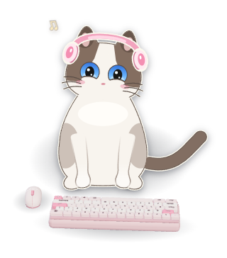
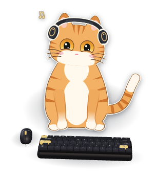
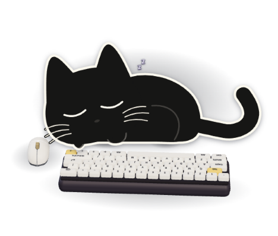
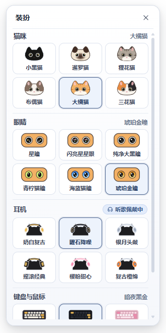
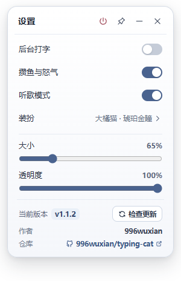

<h1 align="center">打字猫 · Typing Cat</h1>

<p align="center">一只住在 Windows 桌面上的互动小猫。它会跟着你敲键盘、用鼠标、戴耳机听歌晃头，闲下来还会横躺着打盹。</p>

<p align="center">
  <strong><a href="https://github.com/996wuxian/typing-cat/releases">下载 Windows 版</a></strong>
  &nbsp;·&nbsp; <a href="#全新装扮与听歌模式">装扮与听歌</a>
  &nbsp;·&nbsp; <a href="#快速上手">快速上手</a>
  &nbsp;·&nbsp; <a href="#本地开发">本地开发</a>
</p>

<table align="center">
  <tr>
    <td align="center">
      
      <br /><strong>小黑猫打字</strong>
    </td>
    <td align="center">
      
      <br /><strong>布偶猫 · 听歌模式</strong>
    </td>
    <td align="center">
      
      <br /><strong>大橘猫 · 暗夜黑金</strong>
    </td>
  </tr>
  <tr>
    <td align="center">
      
      <br /><strong>横躺打盹</strong>
    </td>
    <td align="center">
      
      <br /><strong>装扮中心</strong>
    </td>
    <td align="center">
      
      <br /><strong>独立设置弹窗</strong>
    </td>
  </tr>
</table>

## 全新装扮与听歌模式

- **6 款猫咪花色**：支持在 **小黑猫**、**暹罗猫**、**狸花猫**、**布偶猫**、**大橘猫**、**三花猫** 之间实时切换，每种猫咪都有专属花纹、渐层爪袜与动态花尾。
- **7 款猫瞳样式（可视化预览）**：提供 **星瞳（默认）**、**闪亮星星眼**、**纯净大黑瞳**、**青柠猫瞳**、**琥珀金瞳**，以及彩猫专属的 **海蓝猫瞳** 与小黑猫专属的 **极简白圈**。
- **6 款经典头戴式耳机**：包含 **奶白复古**、**曜石降噪**、**银月头戴**、**摇滚经典**、**樱粉甜心**、**复古橙绵**，贴合猫耳佩戴并随节拍轻微律动。
- **6 款键鼠联动配色**：提供 **奶白复古**、**暗夜黑金**、**樱粉甜心**、**抹茶奶绿**、**经典灰白**、**海盐晴蓝**，切换时 3D 键盘与鼠标外壳、按键及滚轮会同步换色。
- **听歌模式**：在设置或装扮弹窗中开启后，猫咪会戴上耳机随旋律左右轻晃点头，露出弯弯笑眼并飘起金色音符 `♪ / ♫`；同时怒气值会自动逐渐降低，罢工中的猫咪也能听歌消气重新开工。
- **独立设置与装扮弹窗**：按 `Esc` 弹出不遮挡猫咪的独立设置窗，支持调节 **窗口大小（50%–120%）**、**整体透明度（20%–100%）**、**置顶窗口**、顶部快捷退出（二次确认），并内置 **GitHub 一键检查更新与安装包下载**。

## 快速上手

1. 打开 [GitHub Releases](https://github.com/996wuxian/typing-cat/releases)。下载 `typing-cat.exe` 可直接运行，也可以选择名称以 `-setup.exe` 结尾的安装包。
2. 在猫咪窗口内打字，或直接点击画面中的键帽。按 `Esc`（或右键系统托盘图标选择「设置」）打开独立设置弹窗，点击「装扮」可打开装扮中心自定义猫咪、眼睛、耳机与键鼠主题。
3. 想让猫咪跟着其他窗口里的键盘输入动起来，可以开启「后台打字」。应用只响应支持的键位，不转换或保存输入文本。

**移动窗口**：长按猫咪非头部区域（身体、键盘、鼠标或周边区域）即可直接拖动窗口，也可以按住 `Alt` + 鼠标左键在任意位置拖动；长按头部则专用于抚摸，不会误触发移动。

关闭窗口或按 `Alt+F4` 会最小化到任务栏。点击任务栏图标或再次启动打字猫即可恢复窗口。要退出应用，可在设置弹窗右上角点击电源图标二次确认退出，或右键系统托盘图标选择「退出打字猫」。

## 试试这些互动

| 操作 | 猫咪的反应 |
| --- | --- |
| 按住键盘上的键 | 猫爪会按住对应的键帽，松手后再抬起；按 **空格键** 时猫咪会用尾巴敲击并迸发小特效。 |
| 移动或点击鼠标 | 猫咪眼睛与头部会跟随光标，并用一只前爪操作鼠标。 |
| 长按或轻揉猫咪头部 | 猫咪会眯眼脸红、飘起渐隐小爱心，还会发出喵叫。 |
| 开启「听歌模式」 | 戴上选中的头戴式耳机随旋律晃头、露出弯弯笑眼并飘出音符，同时持续消气。 |
| 快速敲键 | 猫咪会皱眉生气，头右上方循环飘起 `💢`，身后还会冒出火焰与火星。 |
| 连按三次 `.`、`Backspace` 或 `Delete` | 句号会让它无语，退格和删除会让它露出委屈的表情。 |
| 闲置约 10 秒 | 猫咪会横躺下来闭眼打盹，头旁飘起 `Zzz` 并偶尔轻甩尾巴。打字、移动鼠标、点击或抚摸都能唤醒它。 |

## 攒鱼、怒气与罢工

「攒鱼与怒气」默认开启，可在设置中随时开关，库存、进度与怒气会自动保存在本地。

- 把鼠标移到猫咪身上，头顶会自动展开鱼库存和攒鱼进度条；每累计 **500 次** 有效按键获得 1 条鱼。
- 持续快速打字会累积怒气。怒气达到 **30%** 时，猫咪头旁会以艺术字显示 **「怒」** 与百分比；超过 **80%** 后持续冒出 `💢`。
- 怒气满 **100%** 时，猫咪会切换为 **「罢工 · 想吃鱼」** 并横躺下来拒绝打字；此时点击小猫会气鼓鼓地冒出 `💢` 并甩尾巴。把鱼库存里的小鱼拖到猫咪身上（或开启「听歌模式」听歌消气）即可让它消气复工。

## 本地开发

桌面应用使用 Tauri 2、React、Vite 和 Three.js。Windows 构建需要 Node.js、Rust、MSVC C++ Build Tools 和 WebView2。

```powershell
cd desktop
npm ci
npm run tauri:dev
```

构建免安装版、NSIS 安装包和 GitHub Releases 的相关说明见 [桌面版开发与打包](desktop/README.md#开发与打包)。
